# UV-VIS meas User Guide (v2.3.1)

[한국어](USER_GUIDE.md) | **English** | [日本語](USER_GUIDE.ja.md) | [简体中文](USER_GUIDE.zh-CN.md)

This guide walks you through measuring **absorbance** and **fluorescence** with an Ocean Optics / Ocean Insight spectrometer, from installation onwards.

> Every screenshot and number in this guide comes from the **demo mode (simulated spectrometers)** and is **simulated data**.
> You can open the same screens without hardware with `UV-VIS_meas.exe --demo` and follow along.
> Program internals, the reasoning behind the formulas and the hardware settings are described in the [reference manual](README.md) (Korean only).

## Contents

1. [What you need](#1-what-you-need)
2. [Installation](#2-installation)
3. [The main window](#3-the-main-window)
4. [Choosing the measurement settings](#4-choosing-the-measurement-settings)
5. [Measuring absorbance](#5-measuring-absorbance)
6. [Measuring fluorescence](#6-measuring-fluorescence)
7. [Measuring changes over time](#7-measuring-changes-over-time)
8. [Method files](#8-method-files)
9. [Common problems](#9-common-problems)

---

## 1. What you need

| Item | Details |
|---|---|
| PC | Windows 10 / 11. .NET Framework 4.8 is part of Windows |
| Driver | **Ocean Optics OmniDriver** (x86). It is not distributed with this program and must be installed first |
| Spectrometer | An Ocean Optics spectrometer recognised by OmniDriver (Flame-S, Ocean FX, ...), connected by USB |
| Light source | Absorbance: a lamp covering the wavelengths you measure (halogen, deuterium, LED, ...). Fluorescence: an excitation source |
| Sample holder | Cuvettes (usually 10 mm path length) and the solvent your sample is dissolved in |

---

## 2. Installation

### 2.1 Install OmniDriver

Run the OmniDriver installer you received from Ocean Optics first. Afterwards a folder such as
`C:\Program Files (x86)\Ocean Optics\OmniDriverSPAM\OOI_HOME` contains `NETOmniDriver-NET40.dll`.
Connect the spectrometer by USB and check that Windows recognises it.

### 2.2 Download the setup file

Download `UV-VIS_meas-Setup-2.3.1.exe` from [GitHub Releases](https://github.com/Myungsam/UVVIS-Measurement/releases/latest).
To check the download, run this in PowerShell; the result must match the SHA-256 value on the release page.

```powershell
Get-FileHash .\UV-VIS_meas-Setup-2.3.1.exe -Algorithm SHA256
```

### 2.3 Setup wizard

Run the setup file. If **"Windows protected your PC"** appears, click **More info → Run anyway**.
The warning appears because this open-source release is not code-signed.
The wizard is in Korean or English: it follows the Windows display language, and on other languages it first asks you to choose (pick **English**). The screens below are English.

**① Install mode** — **Install for me only** is recommended; it needs no administrator rights.
(The **Cancel** button of this first dialog is drawn by Windows in the system language, so it may not be English.)

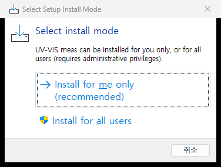

**② Licence** — MIT licence. Select **I accept the agreement** and click **Next**.

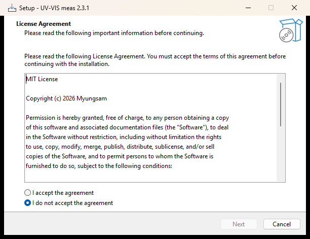

**③ Destination** — keep the default (`%LOCALAPPDATA%\Programs\UV-VIS meas` for a per-user install).
The path in the picture is an example changed for this guide.

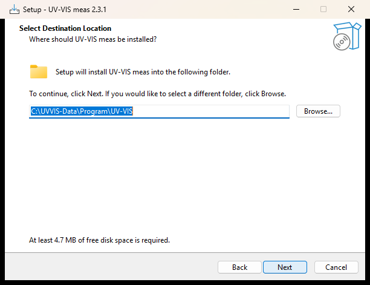

**④ Additional tasks** — tick the desktop shortcut if you want one. A Start menu entry is always created.

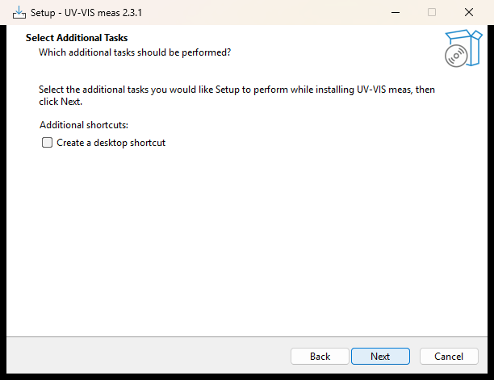

**⑤ Ready to install** → **Install**

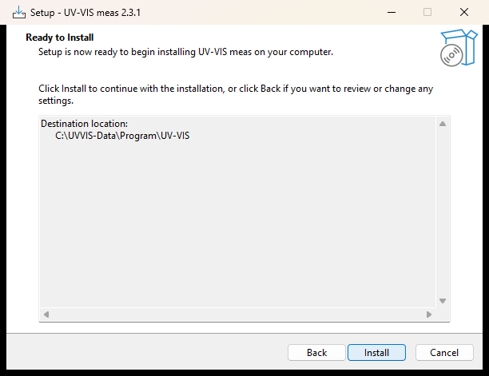

**⑥ Finished** — you can open the short usage notes and start the program from here.

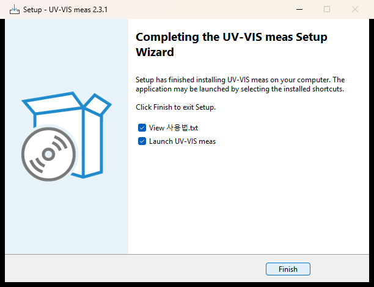

> If OmniDriver is not installed, the setup tells you so at the end. The installation still completes, so you
> can install OmniDriver afterwards.

### 2.4 First start

- Start **UV-VIS meas** from the Start menu.
- If OmniDriver cannot be found automatically, a folder dialog opens. Pick the `OOI_HOME` folder that contains
  `NETOmniDriver-NET40.dll`; you will not be asked again. Answering **No** in that dialog starts the demo mode.
- Only **one copy** of the program runs at a time. Starting it again brings the open window to the front
  (a spectrometer can be opened by only one program).

### 2.5 Demo mode (practice without hardware)

Add ` --demo` to the end of the target in the Start menu shortcut's properties, or run:

```powershell
& "$env:LOCALAPPDATA\Programs\UV-VIS meas\UV-VIS_meas.exe" --demo
```

Two simulated spectrometers open. `[0]` sees light that has passed through a sample, `[1]` sees the lamp directly.
The sample in `[0]` has **absorption bands at 420 nm and 520 nm**, and their strength rises and falls with a **90-second period**.
The window title shows `[DEMO MODE - simulated spectrometers]`.

### 2.6 Updating and uninstalling

- **Update**: run the new setup file; it installs over the old version and keeps your settings.
- **Uninstall**: Windows Settings → Apps, or **Uninstall UV-VIS meas** in the Start menu. The uninstaller asks whether to delete
  the stored settings and error log as well. **Your measurement data is never deleted** (it lives in the folder you chose).

---

## 3. The main window

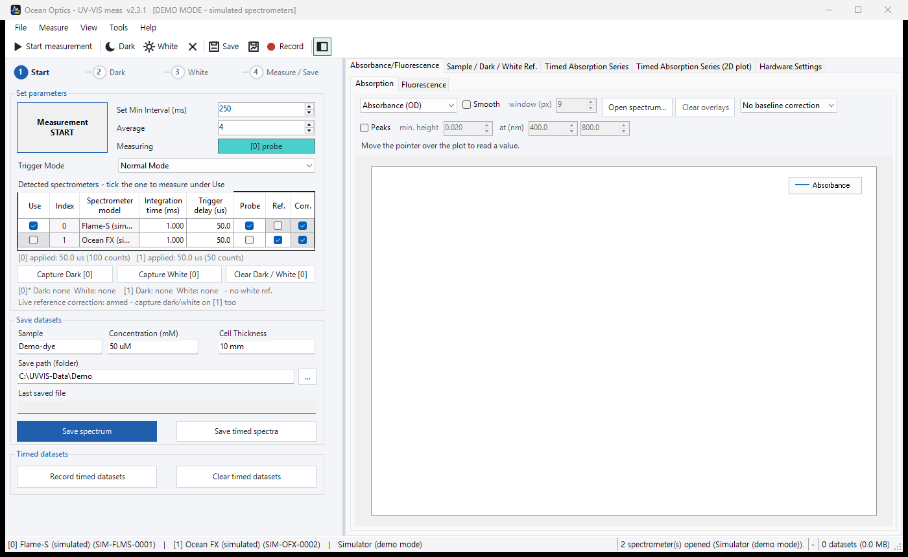

| Area | Contents |
|---|---|
| Menu / toolbar (top) | Start / stop, Dark, White, Save, Record. Frequent actions have shortcuts (table below) |
| Step guide (top left) | Shows the order **Start → Dark → White → Measure / Save**. The blue number is the next step, a green tick is a finished one. Clicking a step runs it |
| Set parameters | Min interval, number of scans to average (**Average**), trigger mode |
| Spectrometer table | Connected spectrometers. The one ticked under **Use** is measured. Integration time and trigger delay are set per row |
| Capture Dark / Capture White | Store the spectrum currently on screen as the dark or white reference |
| Save datasets | Sample name, concentration, cell thickness, save folder |
| Plot tabs (right) | Absorbance/Fluorescence, Sample / Dark / White Ref., Timed Absorption Series, Timed Absorption Series (2D plot), Hardware Settings |
| Status bar (bottom) | Device information, progress, frames per second, accumulated data |

| Shortcut | Action | Shortcut | Action |
|---|---|---|---|
| `F5` | Start / stop measurement | `Ctrl+S` | Save spectrum |
| `Ctrl+D` | Capture Dark | `Ctrl+Shift+S` | Save timed spectra |
| `Ctrl+W` | Capture White | `Ctrl+R` | Start / stop recording timed datasets |
| `Ctrl+1` / `Ctrl+2` | Absorption / Fluorescence plot | `Ctrl+3` | Sample / Dark / White Ref. |
| `Ctrl+4` / `Ctrl+5` | Timed series / 2D plot | `Ctrl+6` | Hardware Settings |
| `Ctrl+P` | Export plot as image (PNG) | `Ctrl+E` | Export measurement report (PDF) |
| `Ctrl+O` | Open a saved spectrum as an overlay | `Ctrl+M` | Load measurement method |
| `F9` | Show / hide the settings panel | `F1` | Open the reference manual |

Change the language under **Tools → Language / 언어** (Korean or English).

---

## 4. Choosing the measurement settings

Matching the signal level before you measure greatly reduces noise in the result.

1. In the spectrometer table, tick **Use** only for the spectrometer you want to measure.
2. Switch the lamp on, insert an empty cuvette (or solvent) and click **Start measurement** (`F5`).
3. Look at the maximum of the signal on the **Sample / Dark / White Ref.** tab (`Ctrl+3`).
4. Adjust **Integration time** in the table until the maximum is **about 50–85 %** of full scale (65535 counts on a Flame-S).
   - If **`SATURATED`** appears in the status bar, shorten the integration time. Absorbance in a saturated region cannot be trusted.
   - If the signal is too small, lengthen the integration time or raise **Average**. Four times as many scans halves the noise.
5. **Set Min Interval** is the lower limit of the refresh interval. For long timed runs, a longer interval keeps the files smaller.

> After changing the integration time or averaging, **capture Dark and White again**: the signal level has changed.

---

## 5. Measuring absorbance

Absorbance tells you how much light the sample absorbs. The program computes it from three spectra:

```
A = -log10( (S - D) / (W - D) )

S : signal with the sample          D : signal with the light blocked (Dark)
W : signal with an empty cuvette or solvent (White, the reference)
```

The order is **Start → Dark → White → sample**. Dark and White store the spectrum **on screen at the moment you click**,
so the measurement must be running first.

### 5.1 Start the measurement

Click **Start measurement** (`F5`). Step ① gets a green tick and the spectrum keeps updating.
The **Sample / Dark / White Ref.** tab shows the incoming light as it is.

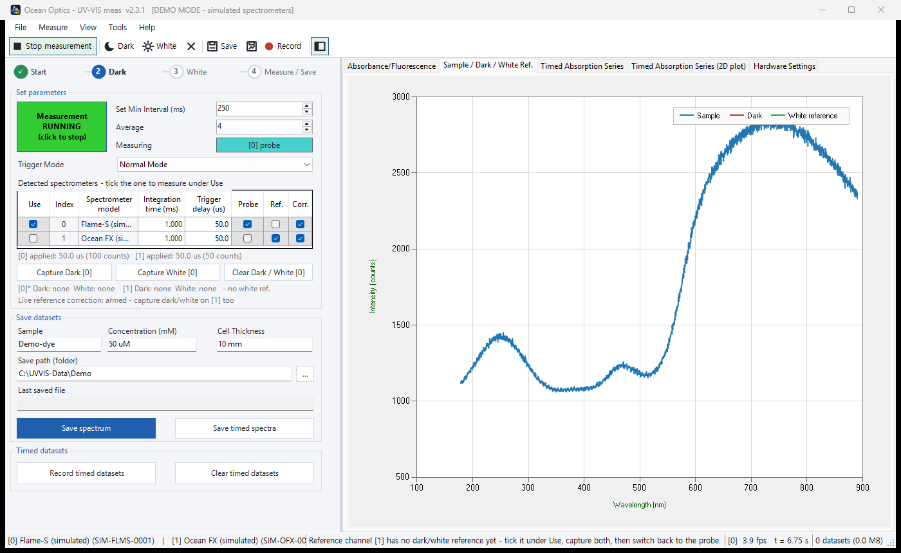

### 5.2 Capture Dark — light blocked

Close the lamp shutter or block the light path with something opaque. When the plot has dropped to a flat baseline,
click **Capture Dark** (`Ctrl+D`).

- Switching the lamp off and on means waiting for its output to settle again, so **a shutter is better**.
- Dark removes the spectrometer's baseline (electrical offset) and ambient light, so keep the room lighting as it will be during the measurement.

> In the **demo mode** the simulated lamp shutter is wired to GPIO 0. On the **Hardware Settings** tab (`Ctrl+6`), set
> spectrometer [0] **GPIO 0 → Direction `Output`, Output `HIGH`** to block the light.
>
> 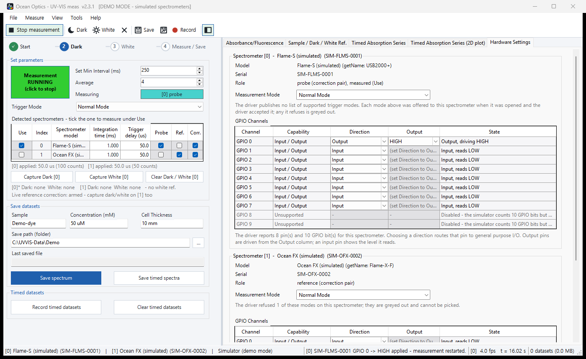

With the light blocked, only a noisy baseline remains (about 1000 counts in the demo).

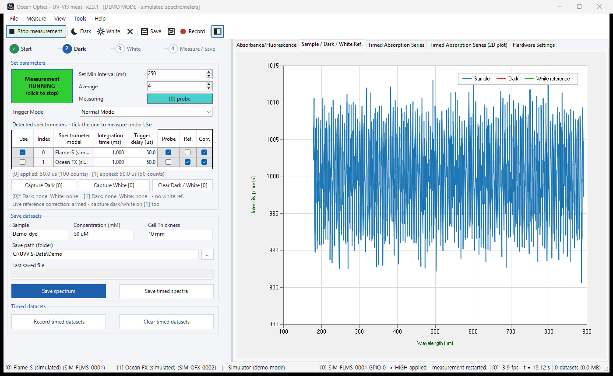

After **Capture Dark** the red trace (Dark) is stored and the step guide moves on to ③ White.
The status bar confirms which spectrometer was stored and its mean value.

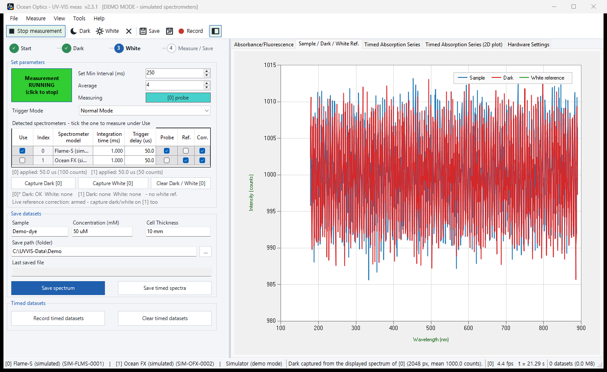

### 5.3 Capture White — empty cuvette or solvent

Open the shutter again and insert a **cuvette with only the solvent** your sample is dissolved in (or an empty cell).
When the signal is steady, click **Capture White** (`Ctrl+W`). The green trace (White) is stored and the step guide moves to ④.

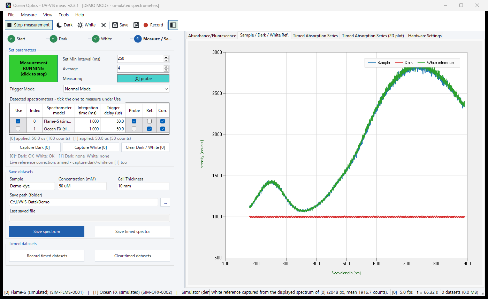

> Always take White with **the same solvent and the same cuvette** as the sample. The absorption and reflection of the solvent
> and cuvette then cancel, leaving the absorbance of the sample alone.

### 5.4 Measure the sample

Insert the sample cuvette and the absorbance spectrum appears at once on the **Absorption** tab (`Ctrl+1`).
The picture shows the demo sample at its strongest absorption, with bands at 420 nm and 520 nm.

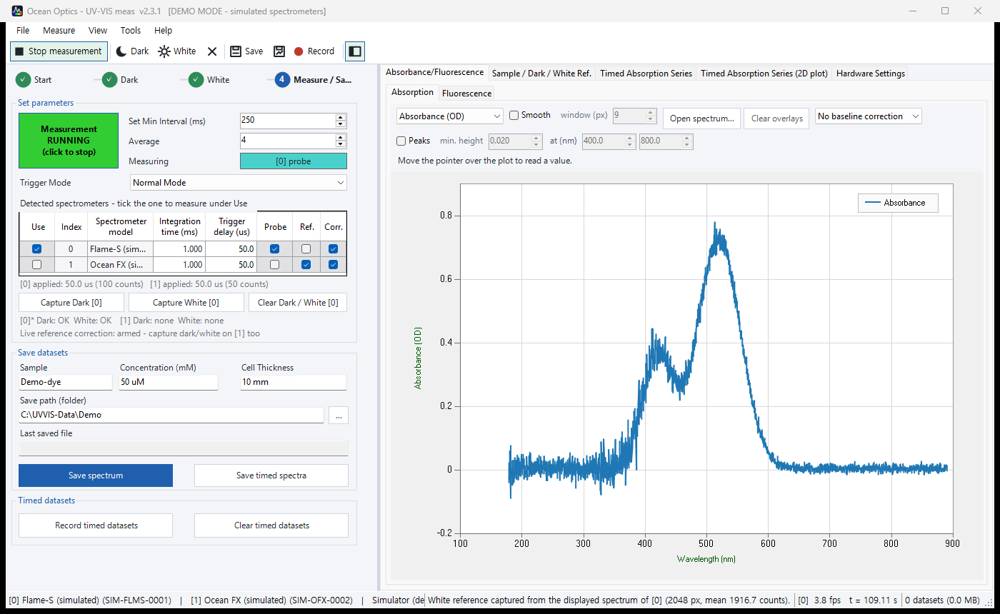

- Absorbance 0 means as much light passes as with the White reference; **1 OD means only 10 % of the light passes**.
- Absorbance is most accurate between **about 0.1 and 1.5 OD**. If it is higher, dilute the sample: too little light gets through and noise grows.
- Gaps in the plot are wavelengths where no value can be computed (almost no light, so `S − D` or `W − D` is zero or below). They are left empty on purpose.

### 5.5 Analysis bar — smoothing, peaks, cursor, concentration

The bar above the absorbance plot changes how the data is shown. **This processing is for display only; the saved CSV always holds the measured values.**

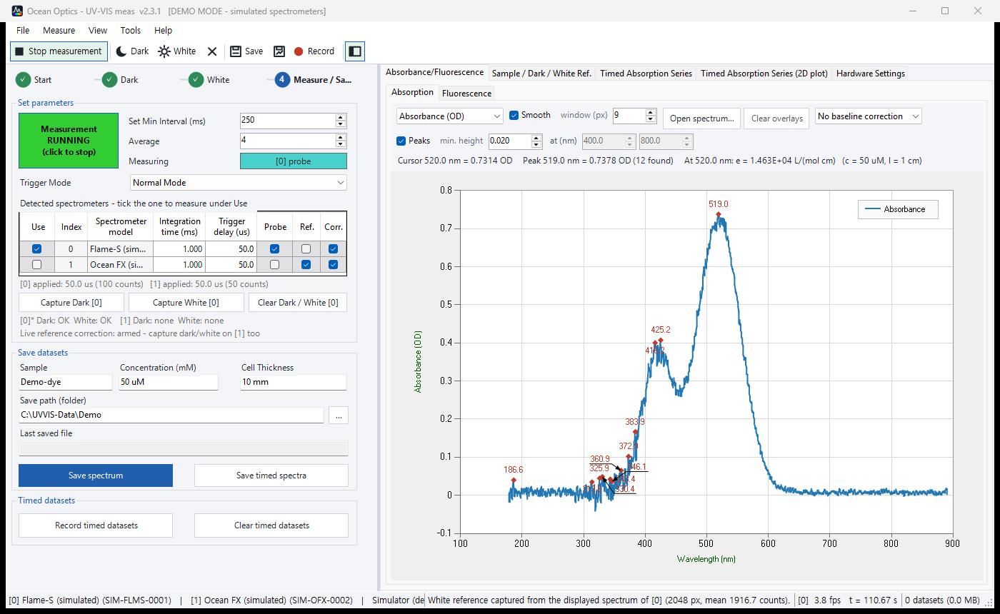

| Control | Use |
|---|---|
| Display | Absorbance (OD) / Transmittance (%T) / Raw counts |
| Smooth | Savitzky-Golay smoothing. A wider **window (px)** is smoother but lowers narrow peaks. 9–21 px is typical |
| Peaks | Marks peaks with red markers and their wavelength. If **noise peaks are marked as well**, as in the picture, raise **min. height** (e.g. 0.020 → 0.1) |
| Baseline | For a tilted or raised baseline: `Baseline: zero at` (one wavelength without absorption), `Baseline: line between` (two points), `Baseline: rubber band` |
| Open spectrum... / Clear overlays | Draws saved CSV files as dashed lines for comparison (`Ctrl+O`) |
| Read-out line | With the pointer over the plot: the **value at the cursor**, the **highest peak** and the **molar absorptivity** |

**Molar absorptivity (Beer-Lambert)** — fill in **Concentration** and **Cell Thickness** under *Save datasets* and the program computes
`ε = A / (c · l)` at the cursor. With the simulated data in the picture:

```
A = 0.7314 OD (520 nm),  c = 50 uM = 5.0×10⁻⁵ mol/L,  l = 10 mm = 1 cm
ε = 0.7314 / (5.0×10⁻⁵ × 1) = 1.463×10⁴ L/(mol·cm)
```

Units may be typed with the value: `50 uM`, `0.05` (a bare number means mM), `1.5 M` / `10 mm`, `1 cm`, `10` (a bare number means mm).

Choose **Transmittance (%T)** under Display to see transmittance: `%T = 100 × 10^-A`.

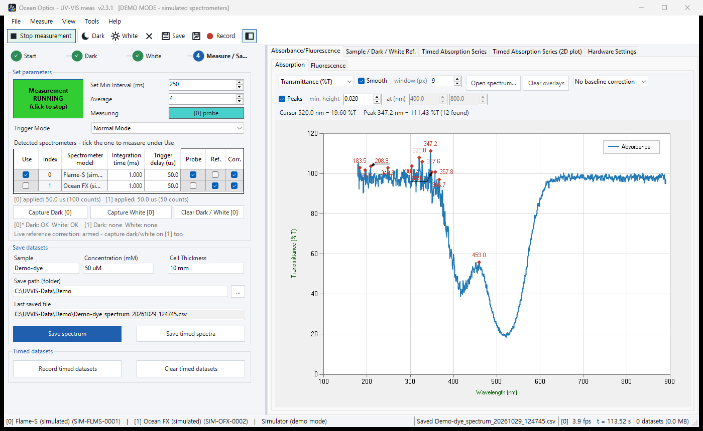

### 5.6 Saving

**Save spectrum** (`Ctrl+S`) writes a CSV file to the save folder:

```
<sample>_spectrum_<date>_<time>.csv        e.g. Demo-dye_spectrum_20261029_082548.csv
```

The `#` lines at the top record the measurement conditions (device, integration time, averaging, trigger delay, reference state,
saturation); the wavelength data follows. The file opens directly in Excel. An excerpt of a simulated file:

```
# Sample,Demo-dye
# Concentration (mM),50 uM
# Cell thickness,10 mm
# Integration (ms),1.000
# Scans to average,4
# Absorbance,A = -log10((S - D) / (W - D))
# Reference state,[0]* Dark: OK  White: OK
# Saturated,no
Wavelength (nm),Sample (counts),Dark (counts),White reference (counts),Absorbance (OD)
420.0191,1081.2946,993.20897,1176.4824,0.31819431
520.0903,1121.5532,990.75193,1681.4119,0.72265239
550.0337,1279.2316,991.72321,1894.2847,0.49682633
```

Because the `Sample`, `Dark` and `White` columns are saved too, you can recompute the absorbance yourself.
For the 520 nm row: `(1121.55 − 990.75) / (1681.41 − 990.75) = 0.1894`, `−log10(0.1894) = 0.7227 OD`, the stored value.

### 5.7 Plot image and measurement report

- **File → Export plot as image** (`Ctrl+P`): saves the current plot as PNG.
- **File → Export measurement report** (`Ctrl+E`): a one-page A4 PDF with the sample, the measurement conditions, the peak list and the plot.

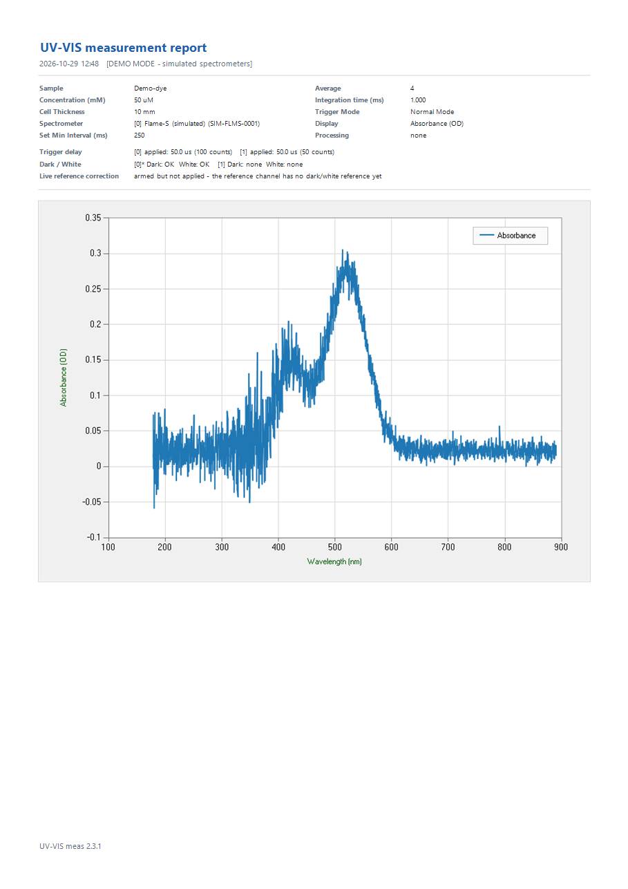

---

## 6. Measuring fluorescence

Fluorescence is the light a sample emits **at other (longer) wavelengths** after excitation. Unlike absorbance it **needs no White reference**,
and you look at the **intensity (counts)** directly, without a formula.

### 6.1 Set-up

- The excitation light and the spectrometer fibre are usually at **90°**, so the excitation light does not enter the spectrometer directly.
- A band-pass filter on the excitation side and a long-pass filter on the spectrometer side reduce scattered excitation light.
- Fluorescence is weak, so the integration time is often **much longer** than for absorbance (hundreds of ms or more). Check that the signal **does not saturate** (chapter 4).

### 6.2 Procedure

1. If you were measuring absorbance, first remove the old references with **Clear Dark / White**.
2. Choose the integration time and averaging (chapter 4), then **Start measurement** (`F5`).
3. **Capture Dark** (`Ctrl+D`): we recommend capturing it **with the solvent-only cuvette and the excitation light on**. This removes the baseline
   together with solvent scattering (including Raman scattering) and ambient light. To remove only the baseline, block the excitation light instead.
4. Insert the sample cuvette and look at the **Fluorescence** tab (`Ctrl+2`).
5. **Save spectrum** (`Ctrl+S`). Do not capture White. The CSV then holds three columns: `Wavelength (nm)`, `Sample (counts)`, `Dark (counts)`.

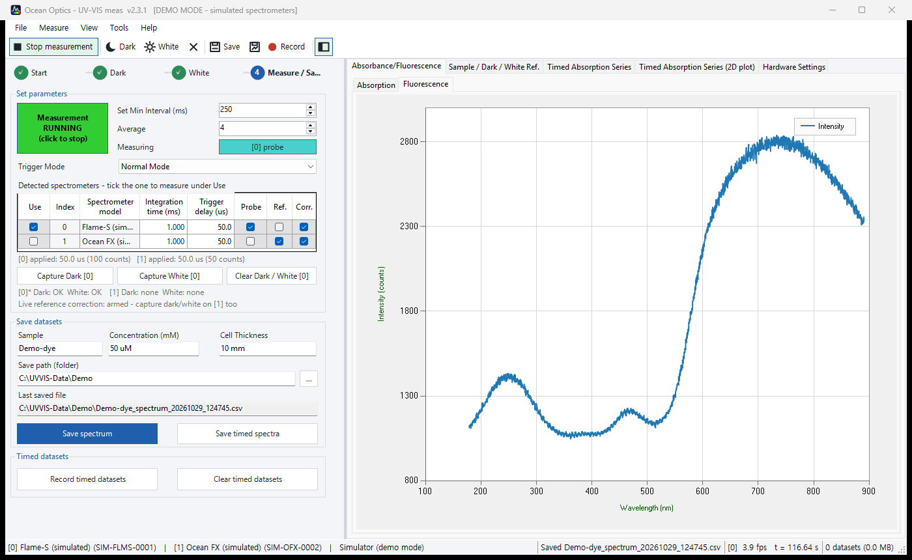

> This picture is from the demo mode. The simulated spectrometer only imitates transmitted light, so it shows **the lamp spectrum, not a real
> fluorescence spectrum**. It is here to show the layout and the procedure.

### 6.3 What the Fluorescence tab shows

The Fluorescence tab draws the **raw counts** read from the spectrometer. **Dark is not subtracted**, so the baseline (offset) is visible.
To use the fluorescence signal alone, compute `Sample − Dark` from the saved CSV. The numbers below are invented for illustration.

| Wavelength (nm) | Sample (counts) | Dark (counts) | Fluorescence = Sample − Dark |
|---|---|---|---|
| 560 | 1,410 | 1,002 | 408 |
| 580 | 3,950 | 1,004 | 2,946 |
| 600 | 6,820 | 1,001 | **5,819** (maximum) |
| 620 | 4,710 | 998 | 3,712 |
| 650 | 1,880 | 1,003 | 877 |

In Excel, with `Sample` in column B and `Dark` in column C, type `=B2-C2` in a new column and fill it down.

**Finding the emission peak** — on the **Absorption** tab, set Display to **Raw counts** and tick **Smooth** and **Peaks**:
the peak wavelengths of the fluorescence spectrum are marked, and `Peak … nm` in the read-out line is the highest one.
Peaks are found by their height above their surroundings, so a constant baseline does not change the result. However **min. height can be set only up to 10**,
so on a counts display noise peaks may be marked as well. A wider smoothing window reduces them.

> To compare fluorescence intensities between days or conditions, keep the integration time, averaging, excitation power and fibre position the same.
> Counts are relative; comparing different instruments in absolute terms needs a separate calibration.

---

## 7. Measuring changes over time

Record how absorbance changes with time, for kinetics or stability tests. Capture Dark and White first (chapter 5).

1. On the **Timed Absorption Series** tab (`Ctrl+4`), enter a **Trace wavelength (nm)** and click **Add**. Several wavelengths can be followed together.
2. Click **Record timed datasets** (`Ctrl+R`). The button changes to **Recording - click to stop**.
3. The absorbance at the trace wavelengths is plotted against time. In the simulated data below, the sample's absorption changes over time.

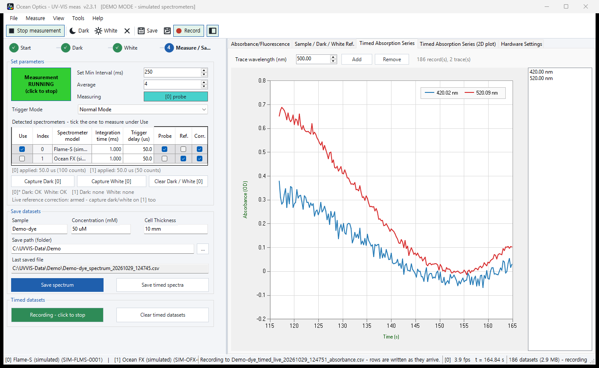

4. The **Timed Absorption Series (2D plot)** tab (`Ctrl+5`) shows time across, wavelength up and absorbance as colour.
   Untick **Auto scale** to set Min / Max (OD) yourself.

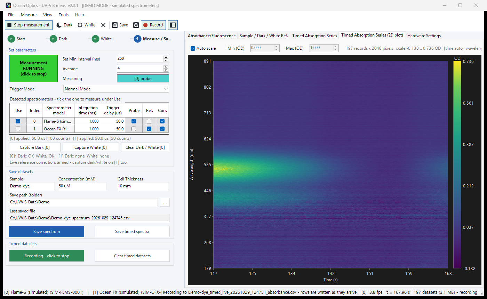

5. Click again to stop recording. **Save timed spectra** (`Ctrl+Shift+S`) saves everything.

**Recording to disk while measuring (data protection)** — while recording, every row is also written **immediately** to two files,
so the data up to that moment survives even if the program stops unexpectedly.

```
<sample>_timed_live_<date>_<time>_absorbance.csv     rows = time, columns = absorbance per wavelength
<sample>_timed_live_<date>_<time>_counts.csv         rows = time, columns = raw counts per wavelength
```

Memory holds only the latest 5000 records and drops the oldest, but the disk files keep everything.
**Save timed spectra** saves what is in memory in the same format (`..._timed_<date>_<time>_absorbance.csv`).

```
Elapsed (s),Timestamp (UTC),178.8000,179.1376,179.4752,...
116.8430,2026-10-28T23:25:54.7510601Z,0.051050305,0.026433554,-0.03545706,...
117.1022,2026-10-28T23:25:55.0103759Z,0.085171446,0.033534959,-0.024552224,...
```

> If the lamp brightness drifts, the absorbance drifts with it. **Live reference correction**, which watches the lamp with a second
> spectrometer and corrects for it, is described in [reference manual §6](README.md#6-흡광도-계산과-dark--white-reference) (Korean).

---

## 8. Method files

Use a method file (`.uvmethod`) to repeat a measurement under the same conditions.

- **File → Save measurement method**: saves the min interval, averaging, each spectrometer's integration time / trigger delay / role, the trace wavelengths and the display / processing settings.
- **File → Load measurement method** (`Ctrl+M`): applies them again. Spectrometers are matched by **serial number**.
- **Dark and White are not included.** References are valid only for that day's lamp and solvent, so **capture them again** after loading a method.

---

## 9. Common problems

| Symptom | What to check |
|---|---|
| No spectrometer found | USB cable, OmniDriver installation. Make sure no other program (OceanView etc.) has the device open |
| Starting again opens no new window | Expected: the running window comes to the front |
| "Windows protected your PC" | The release is not signed. **More info → Run anyway** |
| Absorbance is only noise | Is the lamp on? Was Dark taken with the light blocked, and White with the blank cuvette? |
| `SATURATED` in the status bar | Shorten the integration time and capture Dark and White again |
| Capture Dark / White does nothing | Start the measurement first; the spectrum on screen is what gets stored |
| Too many peaks are marked | Turn on smoothing or raise min. height |
| The light drops out while measuring | Check the lamp and the fibre connectors. The program does not control the lamp |
| The Fluorescence tab baseline is not zero | Expected: that tab shows raw counts without dark subtraction (6.3) |

More symptoms and causes are in [reference manual §10](README.md#10-문제-해결) (Korean).
Errors are logged in `%LOCALAPPDATA%\UV-VIS_meas\error.log`; please attach this file when you report a problem.
