# UV-VIS meas 사용 설명서 (v2.3.1)

Ocean Optics / Ocean Insight 분광기로 **흡광도**와 **형광**을 측정하는 방법을 처음부터 순서대로 설명합니다.

> 이 설명서의 화면과 숫자는 모두 **데모 모드(가상 분광기)** 에서 만든 **가상 데이터**입니다.
> 장비 없이도 `UV-VIS_meas.exe --demo` 로 같은 화면을 띄워 따라 해 볼 수 있습니다.
> 프로그램 내부 구조, 계산식의 근거, 하드웨어 설정의 자세한 내용은 [참고 매뉴얼](README.md)에 있습니다.

## 목차

1. [준비물](#1-준비물)
2. [설치](#2-설치)
3. [화면 구성](#3-화면-구성)
4. [측정 조건 정하기](#4-측정-조건-정하기)
5. [흡광도 측정](#5-흡광도-측정)
6. [형광 측정](#6-형광-측정)
7. [시간에 따른 변화 측정](#7-시간에-따른-변화-측정)
8. [측정 방법 파일](#8-측정-방법-파일)
9. [자주 겪는 문제](#9-자주-겪는-문제)

---

## 1. 준비물

| 항목 | 내용 |
|---|---|
| PC | Windows 10 / 11. .NET Framework 4.8은 Windows에 기본으로 들어 있습니다 |
| 드라이버 | **Ocean Optics OmniDriver** (x86). 이 프로그램과 함께 배포되지 않으므로 먼저 설치해야 합니다 |
| 분광기 | OmniDriver가 인식하는 Ocean Optics 분광기(Flame-S, Ocean FX 등), USB 연결 |
| 광원 | 흡광도: 측정할 파장 구간을 비추는 광원(할로겐, 중수소, LED 등). 형광: 여기광 |
| 시료 용기 | 큐벳(보통 광로 10 mm)과 시료를 녹인 용매 |

---

## 2. 설치

### 2.1 OmniDriver 설치

Ocean Optics에서 받은 OmniDriver 설치 프로그램을 먼저 실행하세요. 설치가 끝나면 보통
`C:\Program Files (x86)\Ocean Optics\OmniDriverSPAM\OOI_HOME` 같은 폴더에 `NETOmniDriver-NET40.dll`이 생깁니다.
분광기를 USB로 연결했을 때 Windows가 장치를 인식하는지도 한 번 확인해 두세요.

### 2.2 설치 파일 받기

[GitHub Releases](https://github.com/Myungsam/UVVIS-Measurement/releases/latest)에서 `UV-VIS_meas-Setup-2.3.1.exe`를 받습니다.
받은 파일이 올바른지는 PowerShell에서 확인할 수 있습니다. 결과가 릴리스 페이지의 SHA-256 값과 같아야 합니다.

```powershell
Get-FileHash .\UV-VIS_meas-Setup-2.3.1.exe -Algorithm SHA256
```

### 2.3 설치 마법사

설치 파일을 실행합니다. **"Windows의 PC 보호"** 창이 뜨면 **추가 정보 → 실행**을 누르세요.
코드 서명을 하지 않은 오픈소스 배포라서 처음 실행할 때 나오는 경고입니다.

**① 설치 모드** — 관리자 권한이 없어도 되는 **현재 사용자용으로 설치**를 권장합니다.

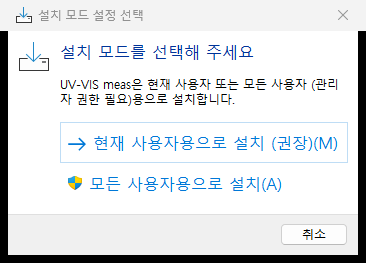

**② 라이선스** — MIT 라이선스입니다. 한국어 화면에는 참고 번역과 영문 원문이 함께 나옵니다. **동의합니다**를 고르고 다음.

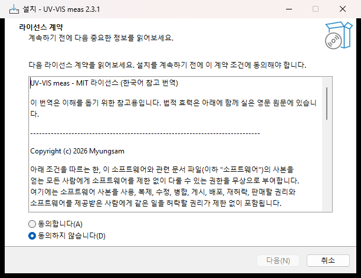

**③ 설치 위치** — 기본값(현재 사용자용은 `%LOCALAPPDATA%\Programs\UV-VIS meas`)을 그대로 두면 됩니다.
아래 그림의 경로는 설명용으로 바꾼 예시입니다.

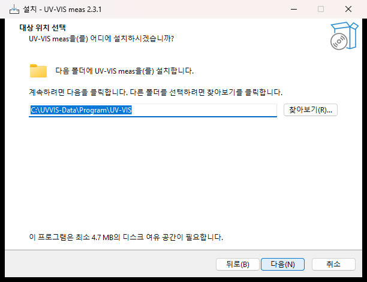

**④ 추가 작업** — 바탕화면 바로가기가 필요하면 체크합니다. 시작 메뉴에는 항상 만들어집니다.

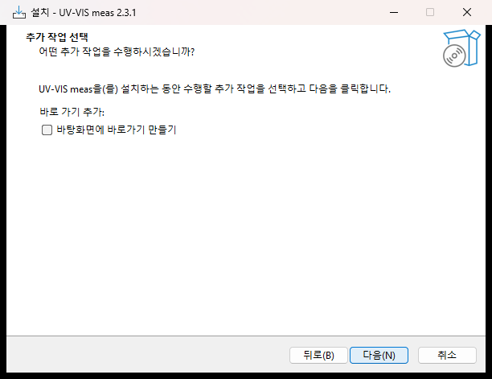

**⑤ 설치 준비 완료** → **설치**

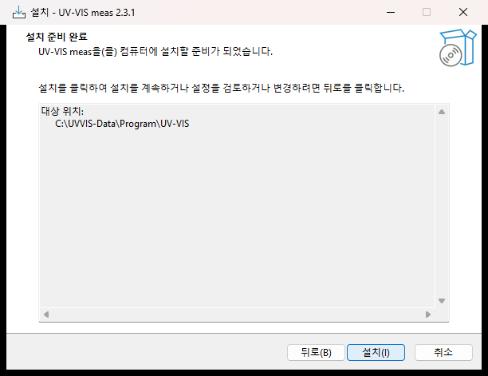

**⑥ 완료** — `사용법.txt 보기`와 `UV-VIS meas 실행`을 고를 수 있습니다.

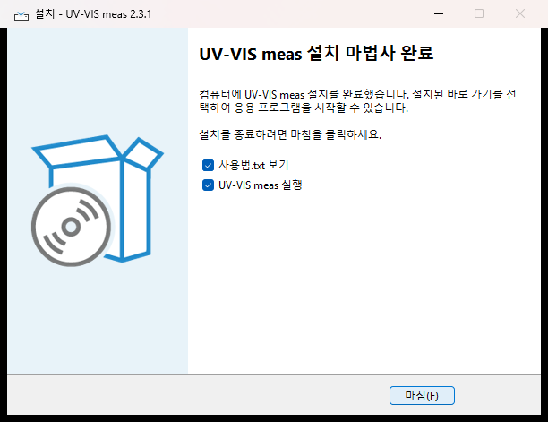

> OmniDriver가 설치돼 있지 않으면 설치 마지막에 그 사실을 알려 줍니다. 설치는 그대로 끝나므로
> OmniDriver를 나중에 설치해도 됩니다.

### 2.4 처음 실행할 때

- 시작 메뉴의 **UV-VIS meas**로 실행합니다.
- OmniDriver를 자동으로 찾지 못하면 폴더 선택 창이 뜹니다. `NETOmniDriver-NET40.dll`이 있는 `OOI_HOME` 폴더를 고르면
  다음부터는 묻지 않습니다. 이 창에서 **아니요**를 누르면 데모 모드로 시작합니다.
- 프로그램은 **한 번에 하나만** 실행됩니다. 이미 실행 중일 때 다시 실행하면 떠 있는 창을 앞으로 가져옵니다
  (분광기는 한 프로그램만 열 수 있기 때문입니다).

### 2.5 데모 모드 (장비 없이 연습하기)

시작 메뉴 바로가기의 속성에서 대상 끝에 ` --demo`를 붙이거나, 설치 폴더에서 다음과 같이 실행합니다.

```powershell
& "$env:LOCALAPPDATA\Programs\UV-VIS meas\UV-VIS_meas.exe" --demo
```

가상 분광기 두 대가 열립니다. `[0]`은 시료를 통과한 빛을, `[1]`은 광원을 직접 봅니다.
`[0]`의 시료는 **420 nm와 520 nm에 흡수대**가 있고, 흡수 세기가 **90초 주기**로 세졌다 약해졌다 합니다.
창 제목에 `[데모 모드 - 가상 분광기]`가 표시됩니다.

### 2.6 업그레이드와 제거

- **업그레이드**: 새 설치 파일을 그대로 실행하면 같은 폴더에 덮어 설치됩니다. 측정 설정은 유지됩니다.
- **제거**: Windows 설정 → 앱, 또는 시작 메뉴의 **UV-VIS meas 제거**. 제거할 때 저장된 설정·오류 기록도 지울지 묻습니다.
  **측정 데이터는 지우지 않습니다**(사용자가 정한 저장 폴더에 있기 때문입니다).

---

## 3. 화면 구성

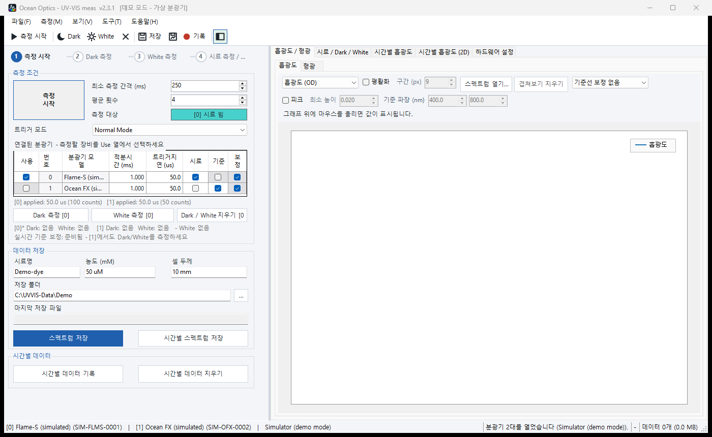

| 위치 | 내용 |
|---|---|
| 메뉴 / 툴바 (맨 위) | 측정 시작·중지, Dark, White, 저장, 시간별 기록. 자주 쓰는 동작은 단축키가 있습니다(아래 표) |
| 단계 표시 (왼쪽 위) | **측정 시작 → Dark 측정 → White 측정 → 시료 측정/저장** 순서를 보여 줍니다. 파란 번호가 지금 할 차례, 초록 체크는 끝난 단계입니다. 단계를 눌러도 같은 동작이 실행됩니다 |
| 측정 조건 | 최소 측정 간격, 평균 횟수, 트리거 모드 |
| 분광기 표 | 연결된 분광기 목록. **사용(Use)** 에 체크된 분광기 하나를 측정합니다. 적분시간과 트리거 지연은 행마다 따로 정합니다 |
| Dark / White 버튼 | 화면에 떠 있는 스펙트럼을 Dark 또는 White 기준으로 저장합니다 |
| 데이터 저장 | 시료명, 농도, 셀 두께, 저장 폴더 |
| 그래프 탭 (오른쪽) | 흡광도 / 형광, 시료·Dark·White 원시 스펙트럼, 시간별 흡광도, 시간별 흡광도(2D), 하드웨어 설정 |
| 상태 표시줄 (맨 아래) | 장비 정보, 진행 상태, 초당 프레임 수, 누적 데이터 |

| 단축키 | 동작 | 단축키 | 동작 |
|---|---|---|---|
| `F5` | 측정 시작 / 중지 | `Ctrl+S` | 스펙트럼 저장 |
| `Ctrl+D` | Dark 측정 | `Ctrl+Shift+S` | 시간별 스펙트럼 저장 |
| `Ctrl+W` | White 측정 | `Ctrl+R` | 시간별 데이터 기록 시작/중지 |
| `Ctrl+1` / `Ctrl+2` | 흡광도 / 형광 그래프 | `Ctrl+3` | 시료 / Dark / White |
| `Ctrl+4` / `Ctrl+5` | 시간별 흡광도 / 2D | `Ctrl+6` | 하드웨어 설정 |
| `Ctrl+P` | 그래프를 PNG로 저장 | `Ctrl+E` | PDF 측정 보고서 |
| `Ctrl+O` | 저장한 스펙트럼 겹쳐 보기 | `Ctrl+M` | 측정 방법 불러오기 |
| `F9` | 설정 패널 접기/펴기 | `F1` | 참고 매뉴얼 열기 |

언어는 **도구 → 언어 / Language**에서 한국어와 English 중에 고릅니다.

---

## 4. 측정 조건 정하기

측정을 시작하기 전에 신호 크기를 맞춰 두면 결과의 잡음이 크게 줄어듭니다.

1. 분광기 표에서 측정할 분광기의 **사용** 칸만 체크합니다.
2. 광원을 켜고, 빈 셀(또는 용매)을 넣은 상태에서 **측정 시작**을 누릅니다(`F5`).
3. **시료 / Dark / White** 탭(`Ctrl+3`)에서 신호의 최대값을 봅니다.
4. 최대값이 장비 만점(Flame-S는 65535 counts)의 **약 50–85%** 가 되도록 표의 **적분시간**을 조절합니다.
   - 상태 표시줄에 **`SATURATED`(포화)** 가 뜨면 적분시간을 줄이세요. 포화된 구간의 흡광도는 믿을 수 없습니다.
   - 신호가 너무 작으면 적분시간을 늘리거나 **평균 횟수**를 늘립니다. 평균 횟수를 4배로 하면 잡음은 약 절반이 됩니다.
5. **최소 측정 간격**은 화면 갱신 주기의 하한입니다. 시간별 측정을 오래 할 때는 간격을 늘리면 파일 크기가 줄어듭니다.

> 적분시간·평균 횟수를 바꾸면 **이미 찍은 Dark와 White는 새로 찍어야** 합니다. 신호 크기가 달라지기 때문입니다.

---

## 5. 흡광도 측정

흡광도는 시료가 빛을 얼마나 흡수하는지를 나타냅니다. 프로그램은 세 스펙트럼으로 계산합니다.

```
A = -log10( (S - D) / (W - D) )

S : 시료를 넣었을 때의 신호      D : 빛을 막았을 때의 신호(Dark)
W : 빈 셀·용매를 넣었을 때의 신호(White, 기준)
```

순서는 **측정 시작 → Dark → White → 시료**입니다. Dark와 White는 버튼을 누른 순간 **화면에 떠 있는 스펙트럼**을 저장하므로,
반드시 측정을 먼저 시작해야 합니다.

### 5.1 측정 시작

**측정 시작**(`F5`)을 누르면 단계 표시의 ①에 초록 체크가 생기고 스펙트럼이 계속 갱신됩니다.
**시료 / Dark / White** 탭에서 지금 들어오는 빛을 그대로 볼 수 있습니다.

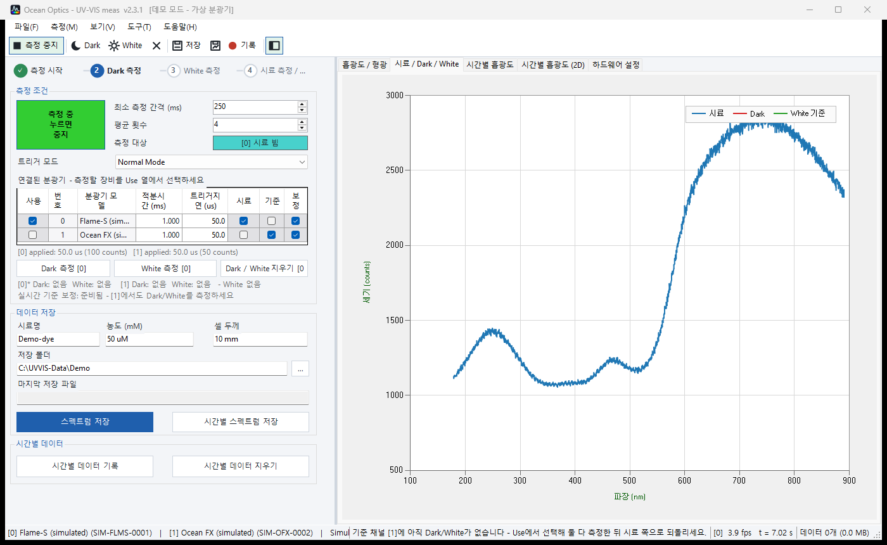

### 5.2 Dark 측정 — 빛을 막고

광원 셔터를 닫거나 광로를 불투명한 것으로 가린 뒤, 그래프가 바닥값 근처로 평평해지면 **Dark 측정**(`Ctrl+D`)을 누릅니다.

- 광원을 껐다 켜는 방식은 다시 켰을 때 출력이 안정될 때까지 기다려야 하므로, **셔터를 쓰는 편이 좋습니다.**
- Dark는 분광기의 바닥값(전기적 오프셋)과 주변광을 함께 뺍니다. 측정 환경의 조명도 실제 측정 때와 같게 두세요.

> **데모 모드**에서는 가상 광원의 셔터가 GPIO 0번에 연결돼 있습니다. **하드웨어 설정** 탭(`Ctrl+6`)에서
> 분광기 [0]의 **GPIO 0 → 방향 `Output`, 출력 `HIGH`** 로 바꾸면 빛이 막힙니다.
>
> 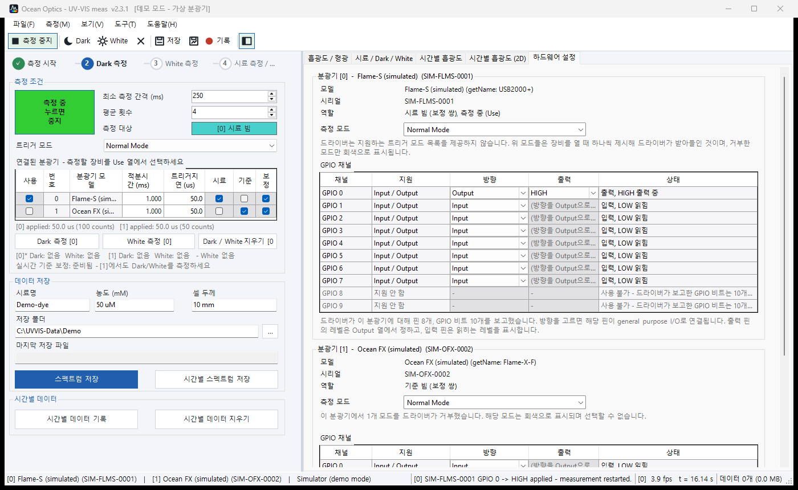

빛이 막히면 그래프는 잡음만 남은 바닥값(데모에서는 약 1000 counts)이 됩니다.

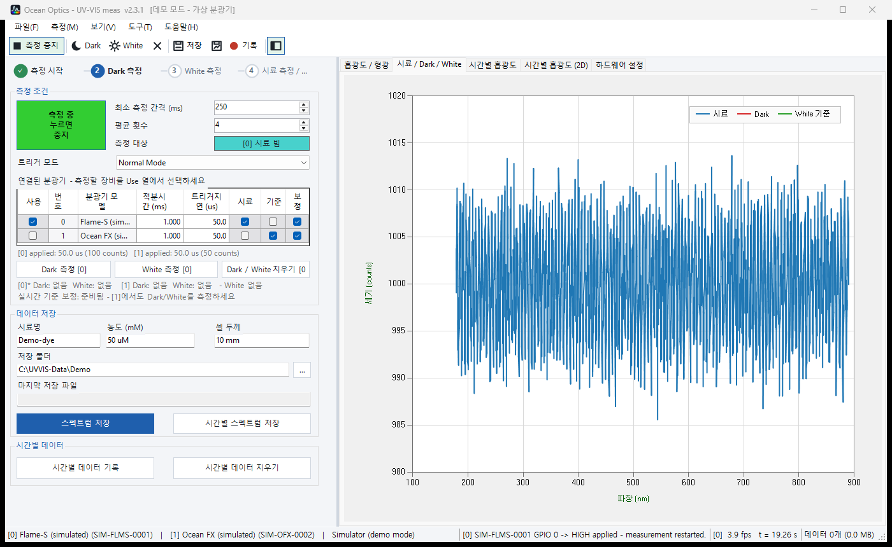

**Dark 측정**을 누르면 빨간 선(Dark)이 저장되고 단계 표시가 ③ White로 넘어갑니다.
상태 표시줄에 `화면에 표시된 [0]의 스펙트럼을 Dark로 저장했습니다 (2048 px, 평균 999.9 counts)`처럼 표시됩니다.

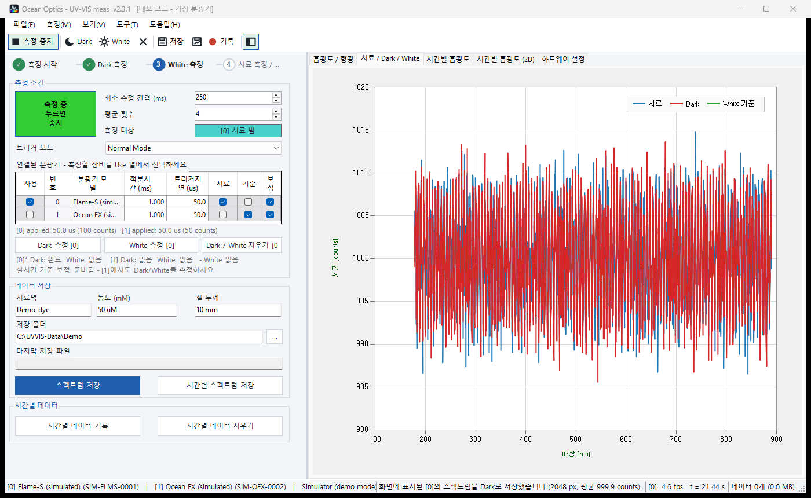

### 5.3 White 측정 — 빈 셀(용매)로

셔터를 다시 열고, **시료를 녹인 용매만 담은 큐벳**(또는 빈 셀)을 넣습니다. 신호가 안정되면 **White 측정**(`Ctrl+W`)을 누릅니다.
초록 선(White 기준)이 저장되고 단계 표시가 ④로 넘어갑니다.

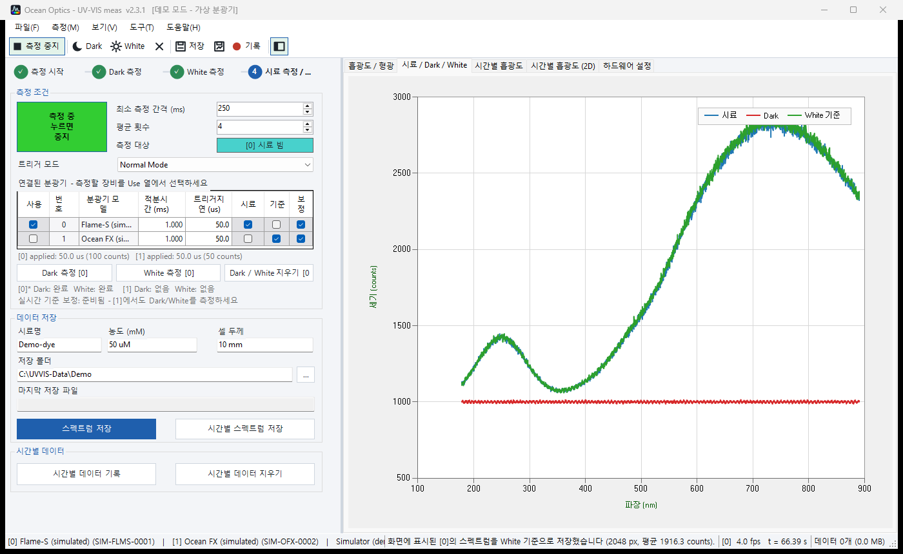

> White는 반드시 **시료와 같은 용매, 같은 큐벳**으로 찍으세요. 용매와 큐벳의 흡수·반사가 함께 빠져서
> 시료만의 흡광도가 남습니다.

### 5.4 시료 측정

큐벳에 시료를 넣으면 **흡광도** 탭(`Ctrl+1`)에 흡광도 스펙트럼이 바로 나타납니다.
아래는 데모 시료의 흡수가 가장 강해진 순간으로, 420 nm와 520 nm의 흡수대가 보입니다.

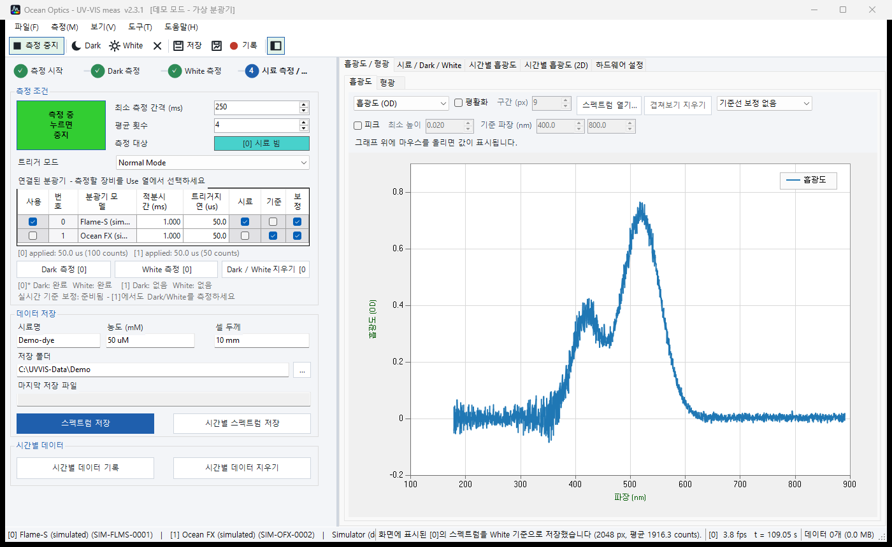

- 흡광도 0은 White와 같은 양의 빛이 통과한다는 뜻이고, **1 OD는 빛의 10%만 통과**한다는 뜻입니다.
- 흡광도가 **약 0.1–1.5 OD** 범위일 때 가장 정확합니다. 더 크면 시료를 묽히세요. 통과하는 빛이 너무 적으면 잡음이 커집니다.
- 그래프가 비어 있는 파장은 값을 계산할 수 없는 곳입니다(빛이 거의 없어 `S − D` 나 `W − D`가 0 이하인 경우). 일부러 비워 둡니다.

### 5.5 분석 막대 — 평활화, 피크, 커서, 농도

흡광도 그래프 위의 막대에서 화면 표시를 바꿀 수 있습니다. **이 처리는 화면에만 적용되고, 저장되는 CSV는 측정값 그대로입니다.**

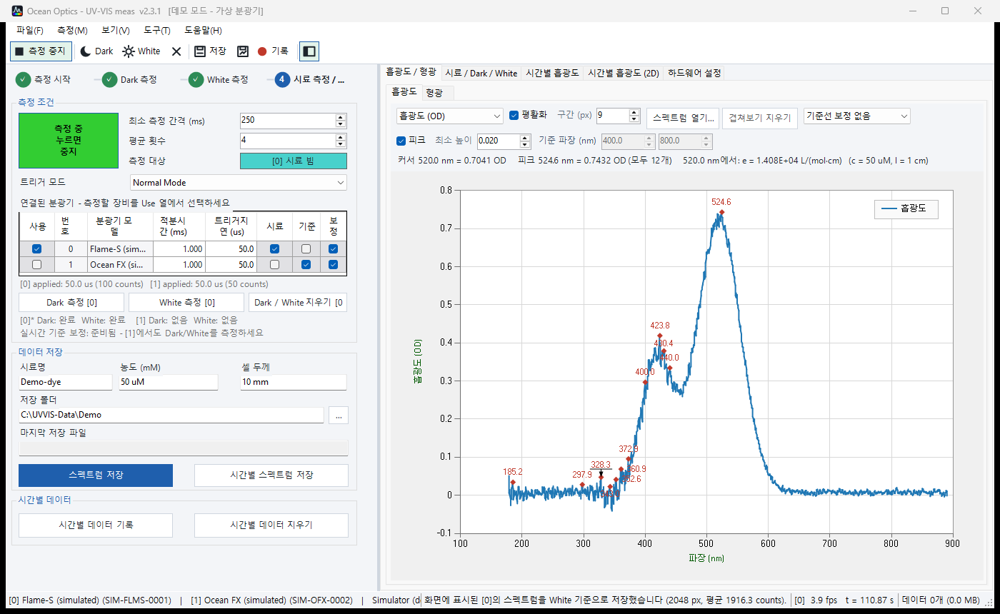

| 항목 | 사용법 |
|---|---|
| 표시 방식 | 흡광도(OD) / 투과율(%T) / 원시 counts |
| 평활화 | 체크하면 Savitzky-Golay 평활화. **구간(px)** 이 클수록 매끄러워지지만 좁은 피크가 낮아집니다. 9–21 px가 보통입니다 |
| 피크 | 체크하면 봉우리에 빨간 표식과 파장이 붙습니다. 위 그림처럼 **잡음 봉우리까지 잡히면 최소 높이를 올리세요**(예: 0.020 → 0.1) |
| 기준선 보정 | 바탕이 기울었거나 떠 있을 때. `0으로 맞출 파장`(흡수가 없는 파장 하나), `두 점 직선`, `아래 포락선` |
| 스펙트럼 열기 / 겹쳐보기 지우기 | 저장해 둔 CSV를 점선으로 겹쳐 그려 비교합니다(`Ctrl+O`) |
| 판독 줄 | 그래프 위에 마우스를 올리면 **커서 위치 값**, **가장 높은 피크**, **몰흡광계수**가 표시됩니다 |

**몰흡광계수(Beer-Lambert)** — 데이터 저장 상자의 **농도**와 **셀 두께**를 채우면 커서 위치에서 `ε = A / (c · l)`을 계산합니다.
위 그림의 가상 데이터로 계산하면 다음과 같습니다.

```
A = 0.7041 OD (520 nm),  c = 50 uM = 5.0×10⁻⁵ mol/L,  l = 10 mm = 1 cm
ε = 0.7041 / (5.0×10⁻⁵ × 1) = 1.408×10⁴ L/(mol·cm)
```

농도와 두께에는 단위를 함께 쓸 수 있습니다. `50 uM`, `0.05`(숫자만 쓰면 mM), `1.5 M` / `10 mm`, `1 cm`, `10`(숫자만 쓰면 mm).

**투과율(%T)** 로 보려면 표시 방식에서 고릅니다. `%T = 100 × 10^-A` 입니다.

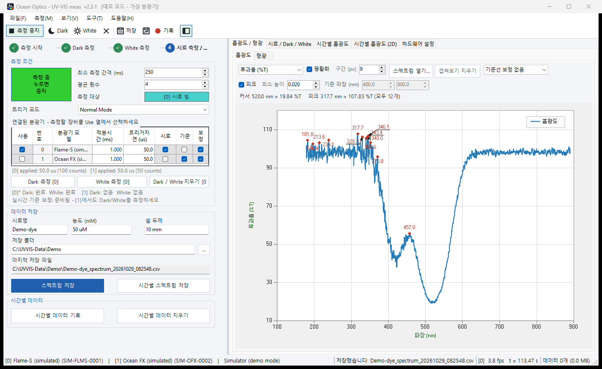

### 5.6 저장

**스펙트럼 저장**(`Ctrl+S`)을 누르면 저장 폴더에 다음 이름으로 CSV가 생깁니다.

```
<시료명>_spectrum_<날짜>_<시각>.csv        예) Demo-dye_spectrum_20261029_082548.csv
```

파일 앞부분의 `#` 줄에는 측정 조건(장비, 적분시간, 평균 횟수, 트리거 지연, 레퍼런스 상태, 포화 여부)이 기록되고,
그 아래에 파장별 데이터가 있습니다. Excel에서 그대로 열 수 있습니다. 가상 데이터의 일부를 보이면 다음과 같습니다.

```
# Sample,Demo-dye
# Concentration (mM),50 uM
# Cell thickness,10 mm
# Integration (ms),1.000
# Scans to average,4
# Absorbance,A = -log10((S - D) / (W - D))
# Reference state,[0]* Dark: OK  White: OK
# Saturated,no
Wavelength (nm),Sample (counts),Dark (counts),White reference (counts),Absorbance (OD)
420.0191,1081.2946,993.20897,1176.4824,0.31819431
520.0903,1121.5532,990.75193,1681.4119,0.72265239
550.0337,1279.2316,991.72321,1894.2847,0.49682633
```

`Sample`, `Dark`, `White` 열이 함께 저장되므로 흡광도를 직접 다시 계산해 확인할 수 있습니다.
520 nm 행을 예로 들면 `(1121.55 − 990.75) / (1681.41 − 990.75) = 0.1894`, `−log10(0.1894) = 0.7227 OD`로 저장된 값과 같습니다.

> CSV의 열 이름과 `#` 줄은 다른 프로그램이 읽을 수 있도록 한국어 화면에서도 영어로 기록됩니다.

### 5.7 그래프 이미지와 측정 보고서

- **파일 → 그래프를 이미지로 저장**(`Ctrl+P`): 지금 보는 그래프를 PNG로 저장합니다.
- **파일 → 측정 보고서 내보내기**(`Ctrl+E`): 시료 정보, 측정 조건, 피크 목록, 그래프가 들어간 A4 한 장 PDF를 만듭니다.

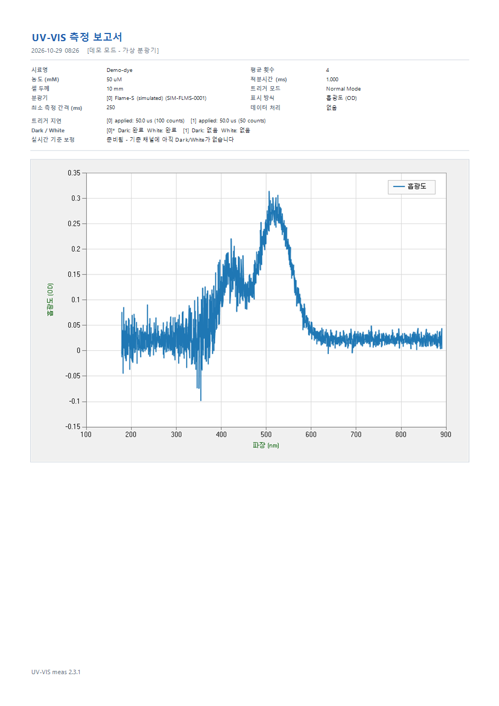

---

## 6. 형광 측정

형광은 여기광을 받은 시료가 **다른(더 긴) 파장으로 내는 빛**을 재는 것입니다. 흡광도와 달라서 **White 기준이 필요 없고**,
계산식 없이 **세기(counts)** 를 그대로 봅니다.

### 6.1 장비 배치

- 여기광과 분광기 광섬유는 보통 **90°** 로 배치해, 여기광이 분광기로 바로 들어가지 않게 합니다.
- 여기광 쪽에 대역 필터, 분광기 쪽에 롱패스 필터를 두면 산란된 여기광이 줄어듭니다.
- 형광은 약하므로 적분시간을 흡광도보다 **길게**(수백 ms 이상) 잡는 경우가 많습니다. 4장과 같이 **포화되지 않는지** 확인하세요.

### 6.2 측정 순서

1. 흡광도를 측정하던 상태라면 **Dark / White 지우기**로 기존 레퍼런스를 먼저 지웁니다.
2. 적분시간과 평균 횟수를 정합니다(4장). 그 다음 **측정 시작**(`F5`).
3. **Dark 측정**(`Ctrl+D`): **용매만 담은 큐벳에 여기광을 비춘 상태**로 찍기를 권합니다. 그러면 바닥값과 함께 용매의 산란(라만 산란 포함)과
   주변광도 빠집니다. 바닥값만 빼려면 여기광을 막고 찍습니다.
4. 시료 큐벳으로 바꾸고 **형광** 탭(`Ctrl+2`)을 봅니다.
5. **스펙트럼 저장**(`Ctrl+S`). White는 찍지 않습니다. 이때 CSV에는 `Wavelength (nm)`, `Sample (counts)`, `Dark (counts)` 세 열만 저장됩니다.

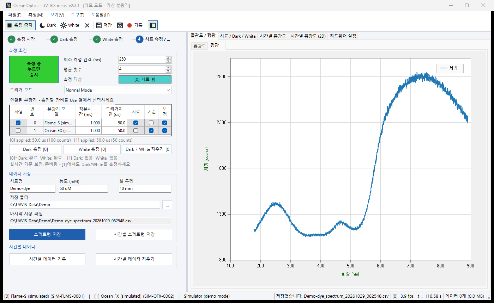

> 위 그림은 데모 모드 화면입니다. 가상 분광기는 투과광만 흉내 내므로 **실제 형광 스펙트럼이 아니라 광원 스펙트럼**이
> 보입니다. 화면 배치와 사용법을 보이기 위한 예시입니다.

### 6.3 형광 탭에 보이는 값

형광 탭은 분광기가 읽은 **원시 counts를 그대로** 그립니다. **Dark를 빼지 않은 값**이므로 바닥값(오프셋)이 함께 보입니다.
형광 신호만 쓰려면 저장한 CSV에서 `Sample − Dark`를 계산하세요. 아래는 설명용 가상 숫자입니다.

| Wavelength (nm) | Sample (counts) | Dark (counts) | 형광 = Sample − Dark |
|---|---|---|---|
| 560 | 1,410 | 1,002 | 408 |
| 580 | 3,950 | 1,004 | 2,946 |
| 600 | 6,820 | 1,001 | **5,819** (최대) |
| 620 | 4,710 | 998 | 3,712 |
| 650 | 1,880 | 1,003 | 877 |

Excel에서는 `Sample`이 B열, `Dark`가 C열일 때 새 열에 `=B2-C2`를 넣고 아래로 채우면 됩니다.

**방출 피크 파장 찾기** — **흡광도** 탭의 분석 막대에서 표시 방식을 **원시 counts**로 바꾸고 **평활화**와 **피크**를 체크하면,
형광 스펙트럼의 봉우리 파장이 표시됩니다. 판독 줄의 `피크 … nm`가 가장 높은 봉우리입니다.
피크는 주변과의 높이 차이로 찾으므로 바닥값이 일정하면 결과가 같습니다. 다만 **최소 높이는 최대 10까지만** 정할 수 있어서,
counts 화면에서는 잡음 봉우리도 함께 표시될 수 있습니다. 평활화 구간을 넓히면 줄어듭니다.

> 서로 다른 날짜나 조건의 형광 세기를 비교하려면 적분시간·평균 횟수·여기광 세기·광섬유 위치를 같게 유지해야 합니다.
> counts는 상대값이며, 장비 간 절대 비교에는 별도의 보정이 필요합니다.

---

## 7. 시간에 따른 변화 측정

반응 속도(kinetics)나 안정성처럼 흡광도가 시간에 따라 어떻게 변하는지 기록합니다. 흡광도 측정(5장)의 Dark와 White를 먼저 찍어 두세요.

1. **시간별 흡광도** 탭(`Ctrl+4`)에서 **추적 파장**을 입력하고 **추가**를 누릅니다. 여러 파장을 함께 볼 수 있습니다.
2. **시간별 데이터 기록**(`Ctrl+R`)을 누르면 기록이 시작됩니다. 버튼이 **기록 중 - 누르면 중지**로 바뀝니다.
3. 추적 파장의 흡광도가 시간에 따라 그려집니다. 아래 가상 데이터에서는 시료의 흡수가 시간에 따라 약해지는 모습이 보입니다.

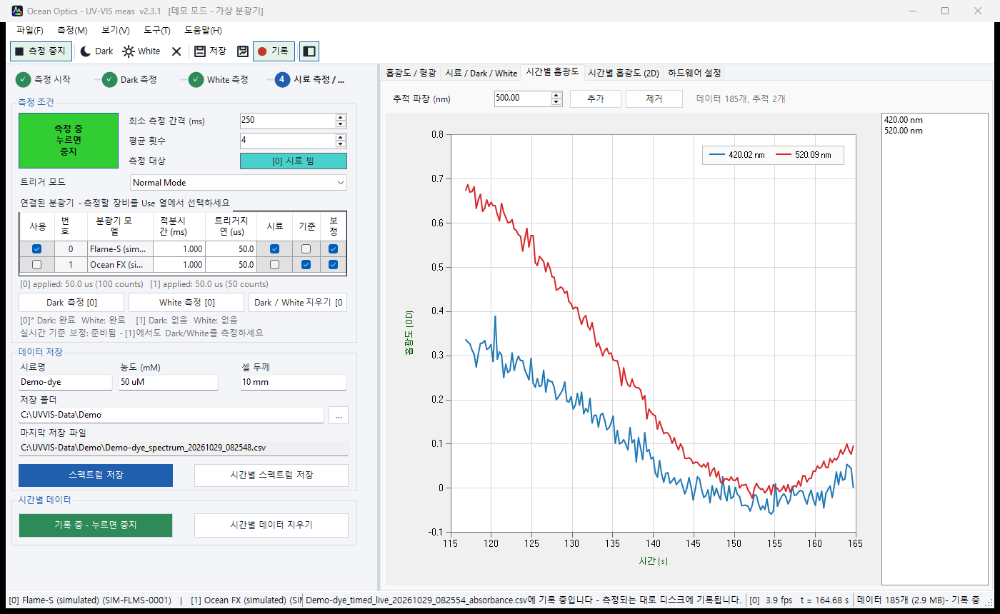

4. **시간별 흡광도 (2D)** 탭(`Ctrl+5`)에서는 가로축 시간, 세로축 파장, 색으로 흡광도를 보여 줍니다.
   **자동 범위**를 끄면 Min / Max(OD)를 직접 정할 수 있습니다.

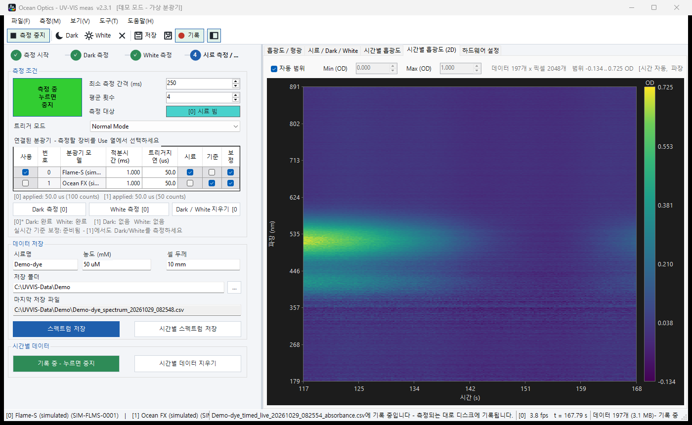

5. 다시 누르면 기록이 멈춥니다. **시간별 스펙트럼 저장**(`Ctrl+Shift+S`)으로 전체를 저장합니다.

**측정 중 디스크 기록(데이터 보호)** — 기록을 켜면 메모리와 동시에 다음 두 파일에 **한 줄씩 바로** 기록합니다.
프로그램이 비정상 종료돼도 그때까지의 데이터가 남습니다.

```
<시료명>_timed_live_<날짜>_<시각>_absorbance.csv     행 = 측정 시각, 열 = 파장별 흡광도
<시료명>_timed_live_<날짜>_<시각>_counts.csv         행 = 측정 시각, 열 = 파장별 원시 counts
```

메모리에는 최근 5000개까지만 보관하고 오래된 것부터 버리지만, 디스크 파일에는 전부 남습니다.
**시간별 스펙트럼 저장**은 메모리에 있는 데이터를 같은 형식으로 저장합니다(`..._timed_<날짜>_<시각>_absorbance.csv`).

```
Elapsed (s),Timestamp (UTC),178.8000,179.1376,179.4752,...
116.8430,2026-10-28T23:25:54.7510601Z,0.051050305,0.026433554,-0.03545706,...
117.1022,2026-10-28T23:25:55.0103759Z,0.085171446,0.033534959,-0.024552224,...
```

> 광원의 밝기가 시간에 따라 변하면 흡광도도 같이 움직입니다. 분광기 두 대로 광원을 동시에 감시해 보정하는
> **실시간 기준 보정**은 [참고 매뉴얼 §6](README.md#6-흡광도-계산과-dark--white-reference)을 보세요.

---

## 8. 측정 방법 파일

같은 조건으로 반복 측정할 때 쓰는 파일입니다(`.uvmethod`).

- **파일 → 측정 방법 저장**: 최소 측정 간격, 평균 횟수, 분광기별 적분시간·트리거 지연·역할, 추적 파장, 표시 방식·처리 설정을 저장합니다.
- **파일 → 측정 방법 불러오기**(`Ctrl+M`): 저장한 조건을 다시 적용합니다. 분광기는 **시리얼 번호**로 찾습니다.
- **Dark / White는 들어 있지 않습니다.** 레퍼런스는 그날의 광원과 용매에만 유효하므로, 방법 파일을 불러온 뒤에도 **새로 찍어야** 합니다.

---

## 9. 자주 겪는 문제

| 증상 | 확인할 것 |
|---|---|
| 분광기가 0대로 나옴 | USB 연결, OmniDriver 설치. 다른 측정 프로그램(OceanView 등)이 장비를 열고 있지 않은지 |
| 다시 실행했는데 새 창이 안 뜸 | 정상입니다. 이미 실행 중인 창이 앞으로 나옵니다 |
| "Windows의 PC 보호" 경고 | 서명하지 않은 배포라서 나옵니다. **추가 정보 → 실행** |
| 흡광도가 잡음뿐 | 광원이 켜져 있는지, Dark를 빛을 막고 찍었는지, White를 빈 셀로 찍었는지 |
| 상태 표시줄에 `SATURATED` | 적분시간을 줄이고 Dark와 White를 다시 찍기 |
| Dark/White를 눌러도 안 됨 | 측정을 먼저 시작해야 합니다. 화면에 떠 있는 스펙트럼을 저장하는 방식입니다 |
| 피크가 너무 많이 표시됨 | 평활화를 켜거나 최소 높이를 올리기 |
| 측정 도중 빛이 끊김 | 광원과 광섬유 커넥터를 확인. 프로그램은 광원을 제어하지 않습니다 |
| 형광 탭의 바닥이 0이 아님 | 정상입니다. 형광 탭은 Dark를 빼지 않은 원시 counts입니다(6.3) |

더 많은 증상과 원인은 [참고 매뉴얼 §10 문제 해결](README.md#10-문제-해결)에 있습니다.
오류가 나면 `%LOCALAPPDATA%\UV-VIS_meas\error.log`에 기록이 남습니다. 문의할 때 이 파일을 함께 보내 주세요.
